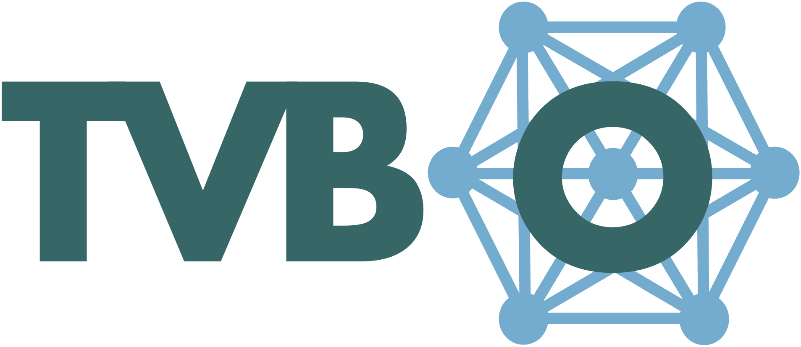
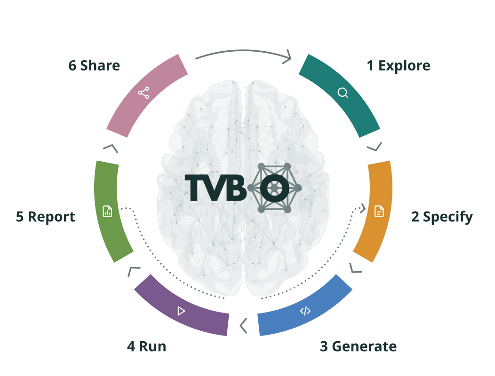
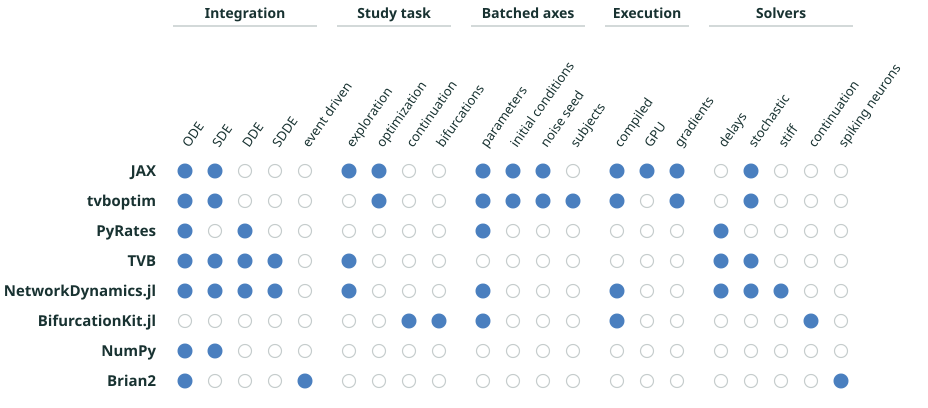
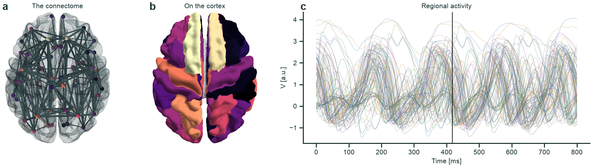
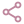

# The Virtual Brain Ontology

[](https://github.com/virtual-twin/tvbo/actions/workflows/ci.yml)
[](https://pypi.org/project/tvbo/)
[](https://pypi.org/project/tvbo/)
[](#license)
[](https://tvbo.charite.de)

`tvbo` is a knowledge base, a metadata standard and a Python toolbox for whole-brain network simulations. You write a whole study (equations, network, coupling, integration, stimuli, observation, figures) as one typed specification grounded in an ontology. From it, `tvbo` generates code for many simulators, runs it on a laptop or a cluster, and writes the report, so the paper, the code and the documentation describe the same experiment.

<picture>
  <source media="(prefers-color-scheme: dark)" srcset="https://raw.githubusercontent.com/virtual-twin/tvbo/main/docs/0-SimulationStudyLifecycle/assets/lifecycle-dark.svg">
  
</picture>

Each step is one chapter of the [documentation](https://virtual-twin.github.io/tvbo/). The sections below walk through all six on one study, `FirstSimulation`: a Generic2dOscillator on an 87-region structural connectome.

<details>
<summary><picture><source media="(prefers-color-scheme: dark)" srcset="https://raw.githubusercontent.com/virtual-twin/tvbo/main/docs/0-SimulationStudyLifecycle/assets/stage-explore-dark.svg"></picture> <b>Explore: find what is curated</b></summary>

Models, connectomes, coupling functions and published studies ship with the package, each under an IRI a specification can point at. Browse them at [tvbo.charite.de](https://tvbo.charite.de), in the [model browser](https://virtual-twin.github.io/tvbo/browser), or from Python with `Dynamics.from_db(...)`. [More on exploring](https://virtual-twin.github.io/tvbo/1-explore/).

| Class | Curated records |
|---|--:|
| `Dynamics` | 112 |
| `Network` | 56 |
| `Coupling` | 9 |
| `SimulationStudy` | 133 |

| Record | Description |
|---|---|
| Generic2dOscillator<br><sub><code>tvbo:models/Generic2dOscillator</code></sub> | The Generic 2-Dimensional Oscillator (G2D) is a phenomenological, coupled, nonlinear two-dimensional (i.e., two state-variables ('V', 'W')) oscillatory, neural mass model. |
| DesikanKilliany (dTOR)<br><sub><code>tvbo:networks/tpl-MNI152NLin2009cAsym_cohort-HCPYA_rec-dTOR_atlas-DesikanKilliany_desc-SC_relmat</code></sub> |  |

</details>

<details>
<summary><picture><source media="(prefers-color-scheme: dark)" srcset="https://raw.githubusercontent.com/virtual-twin/tvbo/main/docs/0-SimulationStudyLifecycle/assets/stage-specify-dark.svg"></picture> <b>Specify: write the experiment</b></summary>

An experiment is YAML (or the same objects in Python). This one references a curated model and connectome by IRI and states only what it changes. [More on specifying](https://virtual-twin.github.io/tvbo/2-specify/).

```yaml
id: 1
label: "A whole-brain simulation"
dynamics:
    iri: tvbo:models/Generic2dOscillator
    parameters: { a: 2.0 } # TVB's limit-cycle setting for this model; the rest stays default
network:
    iri: tvbo:networks/tpl-MNI152NLin2009cAsym_cohort-HCPYA_rec-dTOR_atlas-DesikanKilliany_desc-SC_relmat
    transforms:
        - name: weight
          equation: { rhs: "weight / mean(weight[weight > 0])" }
    coupling:
        c_glob:
            iri: tvbo:coupling_functions/Linear
            delayed: true
            incoming_states: [V]
            parameters: { a: 0.05 }
integration:
    method: Heun
    step_size: 0.1
    duration: 800
    transient_time: 300.0
```

```python
from tvbo import SimulationStudy

study = SimulationStudy.from_file("docs/examples/first-simulation/study.yaml")
```

</details>

<details>
<summary><picture><source media="(prefers-color-scheme: dark)" srcset="https://raw.githubusercontent.com/virtual-twin/tvbo/main/docs/0-SimulationStudyLifecycle/assets/stage-generate-dark.svg"></picture> <b>Generate: compile it to a backend</b></summary>

The specification compiles to readable code for each backend. [More on generating](https://virtual-twin.github.io/tvbo/3-generate/).

```python
print(study.get_experiment(1).render_code("tvboptim"))
```

The model's right-hand side, as the tvboptim backend receives it:

```python
def dynamics(
    self,
    t: float,
    state: jnp.ndarray,
    params: Bunch,
    coupling: Bunch,
    external: Bunch,
) -> Tuple[jnp.ndarray, jnp.ndarray]:
    I = params.I
    a = params.a
    alpha = params.alpha
    b = params.b
    beta = params.beta
    c = params.c
    d = params.d
    e = params.e
    f = params.f
    g = params.g
    gamma = params.gamma
    tau = params.tau

    V = state[0]
    W = state[1]

    c_glob = (
        jnp.atleast_1d(coupling.c_glob)[0] if hasattr(coupling, "c_glob") else 0.0
    )
    local_coupling = (
        jnp.atleast_1d(coupling.local_coupling)[0]
        if hasattr(coupling, "local_coupling")
        else 0.0
    )

    dV_dt = (
        d
        * tau
        * (
            I * gamma
            - V**3 * f
            + V**2 * e
            + V * g
            + V * local_coupling
            + W * alpha
            + c_glob * gamma
        )
    )
    dW_dt = d * (V**2 * c + V * b - W * beta + a) / tau

    # Determine per-node shape from the first state variable; broadcast
    # any scalar derivatives or auxiliaries so jnp.stack sees uniform
    # rank-1 arrays.
    _per_node_shape = jnp.atleast_1d(dV_dt).shape

    derivatives = jnp.stack(
        [
            jnp.broadcast_to(jnp.atleast_1d(dV_dt), _per_node_shape),
            jnp.broadcast_to(jnp.atleast_1d(dW_dt), _per_node_shape),
        ],
        axis=0,
    )

    auxiliaries = jnp.array([])

    return derivatives, auxiliaries
```

What each backend can do:

<picture>
  <source media="(prefers-color-scheme: dark)" srcset="https://raw.githubusercontent.com/virtual-twin/tvbo/main/docs/0-SimulationStudyLifecycle/assets/backends-dark.svg">
  
</picture>

</details>

<details>
<summary><picture><source media="(prefers-color-scheme: dark)" srcset="https://raw.githubusercontent.com/virtual-twin/tvbo/main/docs/0-SimulationStudyLifecycle/assets/stage-run-dark.svg"></picture> <b>Run: execute and read the result</b></summary>

A run executes every experiment, analysis and figure the study declares, in process or as a cluster job (`tvbo run study.yaml`). [More on running](https://virtual-twin.github.io/tvbo/4-run/).

```python
result = study.run()
```

```python
result.figure("first_simulation")
```



The run writes a BIDS-style study directory:

```text
first-simulation/
├── derivatives/
│   └── tvbo/
│       ├── dataset_description.json
│       ├── exp-1_model-Generic2dOscillator_network.h5
│       ├── exp-1_model-Generic2dOscillator_network.yaml
│       ├── exp-1_model-Generic2dOscillator_result.h5
│       └── exp-1_model-Generic2dOscillator_result.yaml
├── docs/
│   └── figures/
│       ├── scripts/
│       ├── first_simulation.caption.qmd
│       ├── first_simulation.gif
│       └── first_simulation.png
└── study.yaml
```

</details>

<details>
<summary><picture><source media="(prefers-color-scheme: dark)" srcset="https://raw.githubusercontent.com/virtual-twin/tvbo/main/docs/0-SimulationStudyLifecycle/assets/stage-report-dark.svg"></picture> <b>Report: write the Methods</b></summary>

The Methods are rendered from the specification, equations and parameter values included, never typed. [More on reporting](https://virtual-twin.github.io/tvbo/5-report/).

```python
result.report("pdf", outputfile="report.pdf")
```

### Generic2dOscillator

The Generic 2-Dimensional Oscillator (G2D) is a phenomenological, coupled, nonlinear two-dimensional (i.e., two state-variables ('V', 'W')) oscillatory, neural mass model. The G2D is a generalization of the well-known FitzHugh-Nagumo model (FitzHugh, 1961; Nagumo et. al, 1962), adapted here for reproducing a wilder class of dynamical configurations of physiological phenomena as observed in neuronal population using phase-portrait method.

$$\dot{V} = d \tau \left(I \gamma + V g + V \mathcal{lo}_{coupling} + W \alpha + c_{glob} \gamma + e V^{2} - f V^{3}\right) \tag{1}$$
$$\dot{W} = \frac{d \left(a + V b + c V^{2} - W \beta\right)}{\tau} \tag{2}$$

| Symbol | Kind | Meaning | Value |
|:--------|:-------------------------|:-------------------------------------------|--------:|
| $V$ | state (coupling, recorded) | V_G2D is the first state-variable of the Generic 2-Dimensional Oscillator model, that can be associated with membrane potentials and sodium activation (FitzHugh, 1961) | 0.1 |
| $W$ | state (recorded) | W_G2D is the second state-variable of the Generic 2-Dimensional Oscillator model, that can be associated with accommodation and refractoriness and considered to represent potassium activation, sodium inactivation, or both (FitzHugh, 1961) | 0.1 |
| $I$ | parameter | Baseline shift of the cubic nullcline | 0 |
| $a$ | parameter | Vertical shift of the configurable nullcline | 2 |
| $\alpha$ | parameter | Constant parameter to scale the rate of feedback from the slow variable to the fast variable. | 1 |
| $b$ | parameter | Linear slope of the configurable nullcline | -10 |
| $\beta$ | parameter | Constant parameter to scale the rate of feedback from the             slow variable to itself | 1 |
| $c$ | parameter | Parabolic term of the configurable nullcline | 0 |
| $d$ | parameter | Temporal scale factor | 0.02 |
| $e$ | parameter | Coefficient of the quadratic term of the cubic nullcline | 3 |
| $f$ | parameter | Coefficient of the cubic term of the cubic nullcline | 1 |
| $g$ | parameter | Coefficient of the linear term of the cubic nullcline | 0 |
| $\gamma$ | parameter | Constant parameter to reproduce FHN dynamics where                excitatory input currents are negative | 1 |
| $\tau$ | parameter | A time-scale hierarchy can be introduced for the state         variables :math:`V` and :math:`W` | 1 |
| $b$ | coupling | Shifts the base of the connection strength while maintaining the absolute difference between different values. | 0 |
| $a$ | coupling | Linear scaling factor of the coupled (delayed) input. | 0.05 |

**Table.** Symbols of the Generic2dOscillator, including those its coupling introduces.


**Coupling: c\_glob**

$$c = b + a \cdot \sum_{j=0}^{-1 + N} {V}_{j,t - {\tau}_{i,j}} \cdot {w}_{i,j} \tag{3}$$

Each source node contributes its own state unmodified; there is no pre-synaptic transformation.

**Post-synaptic:**

$$c_{\text{post}} = b + a \cdot gx \tag{4}$$

Incoming states: $V$; Conduction delays enabled; Symmetry: directed.


### Experiment 1: A whole-brain simulation

87 nodes, Heun at $\Delta t$ = 0.1 ms, run for 800 ms, the first 300 ms discarded.

</details>

<details>
<summary><picture><source media="(prefers-color-scheme: dark)" srcset="https://raw.githubusercontent.com/virtual-twin/tvbo/main/docs/0-SimulationStudyLifecycle/assets/stage-share-dark.svg"></picture> <b>Share: publish to the platform</b></summary>

Push an experiment to [tvbo.charite.de](https://tvbo.charite.de), privately, to named colleagues or to the public gallery, and load it back from Python (`pip install tvbo[api]`). [More on sharing](https://virtual-twin.github.io/tvbo/6-share/).

```python
from tvbo.platform import TVBOPlatform

platform = TVBOPlatform("https://tvbo.charite.de", api_key="<your API key>")
platform.push_experiment(study.get_experiment(1), visibility="shared")
```

</details>

## Installation

```bash
pip install tvbo
```

Requires Python 3.11 or newer. The core install compiles any specification and runs it on JAX; other backends install as extras (`pip install tvbo[tvb]`, `tvbo[julia]`, `tvbo[all]`). See [Installation](https://virtual-twin.github.io/tvbo/installation.html) for every extra and platform note.

## Resources

- [Documentation](https://virtual-twin.github.io/tvbo/)
- [Model browser](https://virtual-twin.github.io/tvbo/browser): models, parameters and equations
- [Metadata schema](https://virtual-twin.github.io/tvbo/datamodel): the TVB-O data model
- [Platform](https://tvbo.charite.de): the knowledge graph and an experiment builder in the browser
- [Issues](https://github.com/virtual-twin/tvbo/issues)
- AI coding assistants: `tvbo skills install` gives Claude Code, Cursor and Copilot the specification format and the knowledge base

## Citation

A manuscript describing `tvbo` is in preparation. Until it appears, please cite the software via this repository and [tvbo.charite.de](https://tvbo.charite.de).

## License

Copyright © 2025 Charité — Universitätsmedizin Berlin. The code and documentation are licensed under the European Union Public Licence (EUPL) v1.2 or later ([LICENSE](https://github.com/virtual-twin/tvbo/blob/main/LICENSE)); the ontology, the LinkML schema and the curated records under [CC BY 4.0](https://github.com/virtual-twin/tvbo/blob/main/LICENSES/CC-BY-4.0.txt). Third-party data files, and records that inline third-party labels, coordinates or values, carry their sources' licences as well, which [REUSE.toml](https://github.com/virtual-twin/tvbo/blob/main/REUSE.toml) states file by file; the licence texts are in [LICENSES](https://github.com/virtual-twin/tvbo/tree/main/LICENSES).

## Funding

P.R. acknowledges support by EU Horizon Europe program Horizon EBRAINS2.0 (101147319), VirtualBrainTwin (101137289), EBRAINS-PREP 101079717, AISN 101057655, EBRAIN-Health 101058516, EIC grant PHRASE 101058240, by the Digital Europe Programme TEF-Health (101100700), Shaiped (101195135), CoordinaTEF (101168074), German Research Foundation SFB 1436 (project ID 425899996), SFB 1315 (project ID 327654276), SFB 936 (project ID 178316478), SPP Computational Connectomics RI 2073/6-1, RI 2073/10-2, RI 2073/9-1, DFG Clinical Research Group BECAUSE-Y 504745852, Berlin University Alliance OpenMake, the Virtual Research Environment at the Charité Berlin, EBRAINS Health Data Cloud, and the Berlin Institute of Health and Foundation Charité. P.R. and J.M. acknowledge additional support by the Deutsche Forschungsgemeinschaft (DFG) — Project-ID 424778381 — TRR 295.
