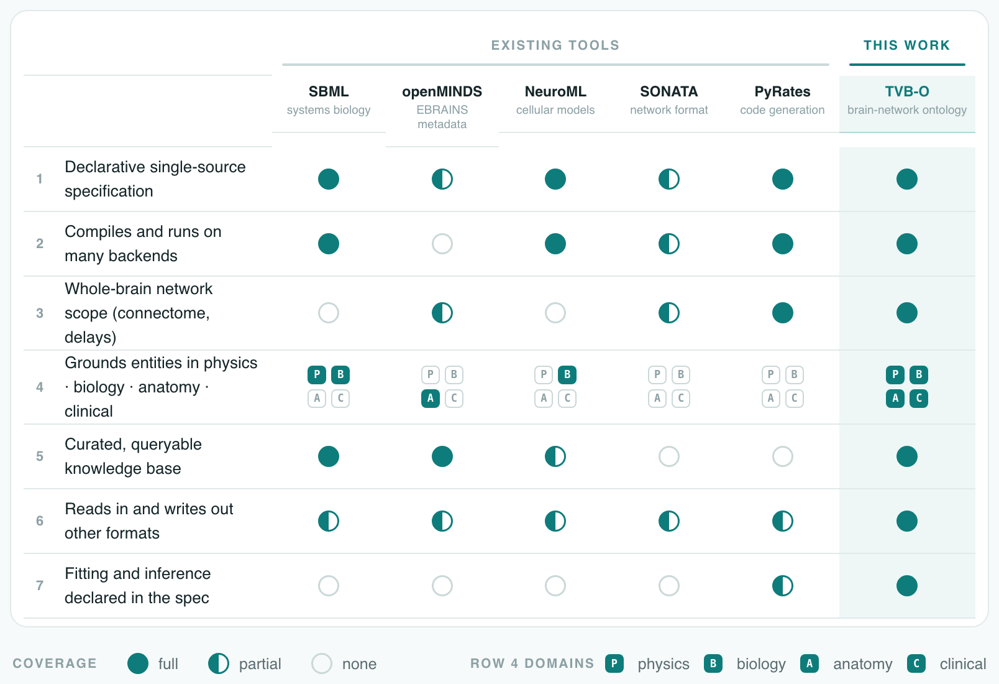

TVBO provides seamless interoperability with various neuroimaging tools, optimization frameworks, and metadata standards. This enables researchers to leverage specialized capabilities from different ecosystems while maintaining a unified model representation.

## How TVB-O relates to existing tools

TVB-O extends and aligns to existing standards rather than replacing them. It delegates execution to simulators and supplies the semantic layer that keeps results interoperable. SBML established the declarative, annotated pattern for biochemical networks; NeuroML/LEMS covers the cellular layer; BIDS and SONATA standardize data and cellular-resolution networks; PyRates compiles one model to several backends. What none of them provide is the grounding: a whole-brain model and its full experiment as one typed object that is executable, biologically grounded, and queryable at once. TVB-O fills that gap and treats the others as backends or alignment targets.

{fig-alt="Tool coverage matrix: seven capabilities (declarative single-source spec, compiles and runs on many backends, whole-brain network scope, four-domain grounding, curated queryable knowledge base, format interoperability, fitting and inference in the spec) across SBML, openMINDS, NeuroML, SONATA, PyRates and TVB-O. Only the TVB-O column is complete."}

## Integration Overview

```{mermaid}
%%| fig-width: 10
flowchart LR
    subgraph TVBO["TVBO Core"]
        D[Dynamics]
        S[SimulationExperiment]
        N[Network]
        D --> S
        N --> S
    end

    subgraph Simulation["Simulation Backends"]
        tvboptim
        ND["NetworkDynamics.jl"]
        DiffEq["DifferentialEquations.jl"]
        MTK["ModelingToolkit.jl"]
    end

    subgraph Analysis["Analysis Backends"]
        PR[PyRates]
        BK["BifurcationKit.jl"]
        PyCoBi["PyCoBi / AUTO-07p"]
    end

    subgraph Standards["Standards & Schemas"]
        BIDS
        OpenMINDS
        LEMS["NeuroML / LEMS"]
    end

    S --> Simulation
    S --> Analysis
    S --> Standards


    style TVBO fill:none,stroke:#333
    style Simulation fill:none,stroke:#333
    style Analysis fill:none,stroke:#333
    style Standards fill:none,stroke:#333
```

## Available Integrations

### Simulation Backends

| Integration | Input | Direction | Description |
|-------------|-------|-----------|-------------|
| [tvboptim](tvboptim/index.qmd) | SimulationExperiment | Bidirectional | JAX-compiled simulation with autodiff optimization |
| [NetworkDynamics.jl](NetworkDynamics.jl/index.qmd) | SimulationExperiment + Network | Export | Julia graph-based network simulation [@Lindner2021] |
| [ModelingToolkit.jl](ModelingToolkit.jl/index.qmd) | SimulationExperiment or Dynamics | Export | Symbolic ODE system via Julia MTK |
| DifferentialEquations.jl | SimulationExperiment | Export | Julia ODE/SDE solvers |

### Analysis Backends

| Integration | Input | Direction | Description |
|-------------|-------|-----------|-------------|
| [PyRates](Pyrates/index.qmd) | SimulationExperiment or Dynamics | Bidirectional | Dynamical systems analysis and simulation [@Gast2023] |
| [BifurcationKit.jl](BifurcationKit.jl/index.qmd) | Dynamics + Continuation | Export | Julia bifurcation analysis [@Veltz2020] |
| PyCoBi / AUTO-07p | Dynamics + Continuation | Export | Fortran-based numerical continuation via PyRates |

### Standards & Schemas

| Integration | Input | Direction | Description |
|-------------|-------|-----------|-------------|
| [BIDS](BIDS/index.qmd) | SimulationExperiment | Export | Brain Imaging Data Structure [@Poldrack2024; @Schirner2021] |
| [OpenMINDS](OpenMINDS.qmd) | SimulationExperiment | Bidirectional | EBRAINS Knowledge Graph metadata (JSON-LD) |
| [NeuroML / LEMS](NeuroML/index.qmd) | Dynamics, SimulationExperiment | Export | LEMS ComponentType definitions + jNeuroML simulation [@Sinha2024] |

## Quick Start

### Optimization with tvboptim

```python
from tvbo import SimulationExperiment

# Load experiment and run optimization
exp = SimulationExperiment.from_file("experiment.yaml")
results = exp.run()

# Access optimization results
print(results.optimization.fic.history)
```

### Analysis with PyRates

```python
from tvbo import Dynamics

# Export TVBO model to PyRates
model = Dynamics.from_file("JansenRit.yaml")
model.to_yaml(format="pyrates")
```

### Export to BIDS

```python
from tvbo import SimulationStudy

study = SimulationStudy.from_file("Study.yaml")
study.run()  # writes derivatives/tvbo/ inside the study dataset
```

### Export to OpenMINDS

```python
from tvbo import SimulationExperiment

exp = SimulationExperiment.from_file("experiment.yaml")
exp.to_openminds("output/openminds.jsonld")
```
